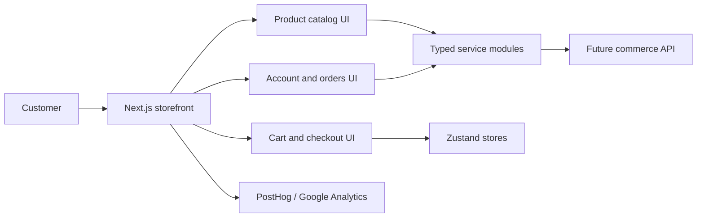

<h1 align="center">Lensora</h1>

<p align="center">
  <strong>Premium eyewear commerce storefront for prescription glasses, sunglasses, and optical accessories.</strong>
  <br />
  <em>A Next.js retail frontend foundation focused on product discovery, mobile-first browsing, checkout readiness, and a crisp gallery-style design system.</em>
</p>

<p align="center">
  <a href="#quick-start"></a>
  <a href="#storefront-plan"></a>
  
  
  
  
  
</p>

---

**Buying eyewear online should make shape, fit, prescription needs, price, and style easy to compare without burying products under noisy interface chrome.**

Lensora is a modern e-commerce storefront foundation for an optical retailer. The project pairs a Next.js 15 frontend shell with a documented architecture for product catalog pages, cart and checkout flows, customer accounts, search, filters and analytics. Product pages include a camera-based virtual try-on; prescription upload remains planned.

The storefront serves **Kính thuốc Anh Thi** in Vĩnh Long. Its shared interface uses navy, light neutral surfaces, Vietnamese typography, restrained rounded controls, and a persistent light/dark preference.

> Current status: home, searchable product categories, 13 collection detail pages, doctor profile, eye-exam information, store contact and lens price sheets are implemented. Checkout, inventory integration and server-side appointment delivery remain outside the current frontend.

## Store photography catalogue

The catalogue uses all **38 owner-supplied photographs** from `eyeglassed_collections/`, organized into 13 collections across Velocity, Stance, BOLON, FACE2FACE, EXFASH, ZIOZIA, Flyar and New Balance. Every displayed catalogue image comes from this folder. Optimized WebP versions live in `frontend/public/images/collections/`; each image record in `frontend/src/data/eyewear-catalog.json` retains its original `sourceFile` for traceability.

Run `node frontend/scripts/import-eyewear-collection.mjs` to regenerate the catalogue and optimized images. The importer checks for duplicate or unassigned photographs and does not fetch any external assets. It preserves full photographs; responsive cards crop them with CSS, while the detail gallery shows the full frame.

Clearly legible sticker prices are recorded as `priceValue`; unknown prices remain `null` and display “Liên hệ”. Sticker prices are not confirmed current selling prices. Budget filters exclude unknown prices, and price sorting keeps them after priced items in either direction. Collection names describe the visible frames when an exact model is unverified; do not transfer model specifications from the retired retailer catalogue.

The catalogue supports brand/category/budget filters, accent-insensitive search and numerical price sorting. `/san-pham/[slug]` provides the collection's photographs and related collections. The old 12 researched-product URLs redirect permanently to `/gong-kinh`. The supplied photographs contain optical frames, so `/kinh-ram` offers store contact until sunglass photographs are available. Existing category URLs remain available; the lens-price link stays hidden on the home page.

Appointment details are checked locally and retained for the customer. Confirmation is through `tel:+84858060789`; the form does not claim to submit a booking to a server.

The home page opens with the supplied 33-second Anh Thi advertisement, served from `frontend/public/videos/gioi_thieu_kinh_thuoc_anh_thi_ngang_1920x1080.mp4`. It preserves the full 16:9 frame on desktop and mobile, starts muted, and offers native playback, sound and fullscreen controls. Visitors who prefer reduced motion start with the poster and can play manually. The poster is extracted from the same video; appointment and catalogue links remain below the player.

---

## Features

<table>
  <tr>
    <td width="50%" valign="top">
      <h3>Eyewear storefront architecture</h3>
      <p>Planned routes cover home, shop, eyeglasses, sunglasses, collections, product detail, cart, checkout, account, orders, about, contact, and FAQ views.</p>
    </td>
    <td width="50%" valign="top">
      <h3>Product discovery model</h3>
      <p>The frontend plan includes product cards, grids, galleries, product info, pricing, reviews, related products, and filters for catalog browsing.</p>
    </td>
  </tr>
  <tr>
    <td width="50%" valign="top">
      <h3>Cart and checkout foundation</h3>
      <p>Cart item, cart summary, checkout form, and order summary components are defined as the core purchasing flow for implementation.</p>
    </td>
    <td width="50%" valign="top">
      <h3>Minimal luxury design system</h3>
      <p>The design reference uses a monochrome palette, square controls, strong typography, generous white space, and image-led product presentation.</p>
    </td>
  </tr>
  <tr>
    <td width="50%" valign="top">
      <h3>State and service boundaries</h3>
      <p>Planned Zustand stores cover cart, wishlist, user, and UI state. Service modules separate products, cart, checkout, customer, and search behavior.</p>
    </td>
    <td width="50%" valign="top">
      <h3>Growth-ready roadmap</h3>
      <p>Try frames with the front-camera preview. Planned features include face shape analysis, AI recommendations, prescription upload, loyalty, gift cards, and a mobile app.</p>
    </td>
  </tr>
</table>

---

## Quick Start

### 1. Install frontend dependencies

```bash
cd frontend
npm install
```

### 2. Run the development server

```bash
npm run dev
```

Open:

- Storefront dev server: `http://localhost:3000`

The development server includes all current storefront routes and the researched catalogue. No external catalogue API or environment variables are needed to browse the site.

---

## Tech Stack

| Layer | Stack |
| --- | --- |
| Frontend | Next.js 15, React 19, TypeScript |
| Styling | Tailwind CSS 4, class-variance-authority, clsx, tailwind-merge |
| UI direction | shadcn/ui conventions, Radix UI patterns, Lucide icons |
| State | Zustand |
| Animation | Framer Motion |
| Planned data layer | TanStack Query, typed service modules |
| Planned forms | React Hook Form, Zod |
| Planned analytics | PostHog, Google Analytics |

---

## Project Structure

```text
.
├── DESIGN_SYSTEM.md        # Visual system reference for the storefront
├── FRONTEND.md             # Frontend architecture, pages, components, and roadmap
├── backend                 # Reserved for future API/backend work
└── frontend
    ├── package.json        # Frontend scripts and dependencies
    ├── next.config.ts      # Next.js configuration
    ├── postcss.config.mjs  # Tailwind CSS PostCSS integration
    ├── tsconfig.json       # TypeScript configuration
    └── src/app/layout.tsx  # Root app layout and metadata
```

Planned frontend structure from `FRONTEND.md`:

```text
src/
├── app/
├── components/
│   ├── ui/
│   ├── layout/
│   ├── product/
│   ├── cart/
│   └── marketing/
├── services/
├── stores/
├── hooks/
├── lib/
├── types/
└── styles/
```

---

## Configuration

The current frontend shell does not require runtime environment variables.

Recommended future environment variables for planned analytics integrations:

| Variable | Description |
| --- | --- |
| `NEXT_PUBLIC_POSTHOG_KEY` | Public PostHog project key. |
| `NEXT_PUBLIC_POSTHOG_HOST` | Optional PostHog host override. |
| `NEXT_PUBLIC_GA_MEASUREMENT_ID` | Google Analytics measurement ID. |

Store local frontend overrides in:

```text
frontend/.env.local
```

---

## How It Works



1. The storefront presents product-led browsing for eyewear categories, collections, and product detail pages.
2. Shared product, cart, marketing, and layout components keep the shopping experience consistent across routes.
3. Zustand stores hold client-side cart, wishlist, user, and UI state.
4. Service modules isolate product, cart, checkout, customer, and search data access.
5. Future backend APIs can plug into the service layer without coupling the UI to transport details.

---

## Storefront Plan

| Area | Planned surface |
| --- | --- |
| Catalog | Home, shop, eyeglasses, sunglasses, collections, product detail, related products |
| Shopping | Wishlist, cart, checkout, order summary |
| Customer | Account, orders, order tracking |
| Content | About, contact, FAQ, newsletter, testimonials |
| Search | Product search, category filters, product filters |
| Virtual try-on | Front-camera preview, face tracking, 2 calibrated frame images from the supplied photographs and PNG export |
| Future eyewear tools | Face shape analysis, prescription upload, AI recommendations |

---

## Design System

The design reference in `DESIGN_SYSTEM.md` is built around a high-end gallery retail aesthetic.

| Token group | Direction |
| --- | --- |
| Color | Navy accent and semantic neutral surfaces in light and dark modes |
| Typography | Clean sans-serif scale for captions, body, subheadings, and headings |
| Shape | 8px surfaces, 6px controls, circular brand marks |
| Elevation | No shadows; hierarchy comes from spacing, contrast, and imagery |
| Imagery | Product and model photography should dominate the layout |

Implementation rules to preserve:

- Keep controls clear, consistent and large enough to tap.
- Avoid gradients, shadows, and decorative color accents.
- Use product imagery as the primary visual content.
- Keep navigation and product metadata concise.

The catalogue layout uses references retrieved through [Inspo MCP](https://inspomcp.dev/mcp): [Warby Parker](https://inspomcp.dev/d/warbyparker-com/DESIGN.md) for eyewear imagery and spacing, and [DUA's collection page](https://inspomcp.dev/d/duabyab-com--collections-skincare/DESIGN.md) for restrained catalogue navigation. Anh Thi keeps its own photography, navy identity, Vietnamese fonts and product information. Brand stories use equal image-led columns, model and reference price form one group, and full product descriptions remain on the detail pages. Provenance is recorded in `outputs/inspo-frontend-2026-10-17/references.json`.

---

## Backend Status

The `backend/` directory is currently empty and reserved for future API work.

Expected backend responsibilities when implemented:

- Product catalog and inventory data.
- Customer accounts and order history.
- Cart, checkout, and payment orchestration.
- Review and rating persistence.
- Search and recommendation endpoints.

---

## Scripts

Run scripts from the `frontend/` directory.

| Command | Description |
| --- | --- |
| `npm run dev` | Start the Next.js development server. |
| `npm run build` | Build the frontend for production. |
| `npm run start` | Start the production Next.js server after a build. |
| `npm run typecheck` | Run TypeScript without emitting files. |
| `npm test -- --run` | Check catalogue filtering, product routes, galleries, appointments and existing storefront behavior. |

---

## Production Deployment

The Kính thuốc Anh Thi production website is [kinhthuocanhthi.com](https://kinhthuocanhthi.com). Deploy production updates to the SSH host `xeleb-prod-kmax`, using the checkout at `/root/Lensora` and `scripts/deploy-frontend-docker.sh`.

The existing Docker container is `lensora-frontend`, with host port `8086` mapped to container port `3000`. Nginx forwards `kinhthuocanhthi.com` and `www.kinhthuocanhthi.com` to `127.0.0.1:8086`. Preserve this setup when updating the application.

After committing, pushing, and checking the changes, deploy from the server:

```bash
ssh xeleb-prod-kmax
cd /root/Lensora
git pull --ff-only origin main
bash scripts/deploy-frontend-docker.sh
```

Verify the container is healthy and check the production website, including `/bang-gia` and PNG downloads. The local Vercel project link is a separate deployment target; it does not update this production server.

## Verification

Run these checks before shipping frontend changes:

```bash
cd frontend
npm run typecheck
npm run build
```

Also run `npm test -- --run` and inspect the affected routes on desktop and mobile. Verify product sources and imagery whenever catalogue records change.

Mobile catalogue controls keep search and brand selection visible, with category, budget and sorting behind “Bộ lọc và sắp xếp” below 861px. Inputs use 16px text to avoid iOS focus zoom. Brand stories scroll horizontally below 761px; product details reserve space for a bottom contact bar and device safe areas. Check portrait and landscape layouts at 375, 414, 667, 768, 1024, 1280 and 1920px, including full-page scrolling, menu access and footer links.

The fixed social contact buttons are configured in `frontend/src/components/marketing/social-contact-rail.tsx`. Zalo uses the store phone number; Facebook links to `kinhthuocanhthi` and TikTok to `@kinhthuocanhthivl`, as confirmed by the store owner. Empty entries stay hidden. The rail hides for printing and while the mobile menu is open, and sits above the product contact bar on small screens.

## Virtual try-on

Product pages include **Thử kính bằng camera** for the calibrated BOLON and New Balance collections. The dialog lets visitors enable their front camera, switch frames,
adjust scale/height, stop/restart the camera and download a PNG. It requests
video only after an explicit click and never requests a microphone. Camera
frames and facial landmarks stay on the device; nothing is uploaded or stored
by the feature. Closing the dialog, leaving the page or hiding the browser tab
stops all media tracks and terminates the face-tracking worker.

Face Landmarker runs in a dedicated worker, at most 15 inferences per second
with one frame in flight. A missed or strongly turned face hides the overlay.
The 2D frame uses each product's photographed front rim, with a calibrated
contour and transparent lenses. Other collections keep their photo galleries; a
camera button appears only after a frame has a calibrated mask. This helps
compare appearance and does not measure physical fit. The dialog states that
limitation and recommends checking fit at the store.

Use HTTPS in production (localhost works for development). Use a recent
Chrome, Edge or Safari with camera, Web Workers and WebAssembly support.
Permission denial, missing/busy cameras, model load failures and interruptions
have retry instructions; the ordinary product gallery and contact links remain
available. The model and WASM are served locally. `predev`/`prebuild` copy the
pinned package's WASM into `public/mediapipe/wasm`, including in the Docker
build; see `frontend/public/mediapipe/README.md` for provenance and checksum.

Validate using a synthetic camera stream, including actual worker inference,
frame switching, missing-face handling, PNG export, permissions, closing during
permission/load, tab hiding and keyboard focus restoration. Test on real iOS
and Android hardware before making browser compatibility claims. Local browser
emulation does not establish real-camera accuracy or frame rates on every device.

## Local search

`frontend/src/lib/site-seo.ts` owns the production origin, page metadata helper and default share image. Every page declares its own canonical, description and Open Graph/Twitter metadata. The home page targets kính thuốc Vĩnh Long; `/do-mat` covers đo mắt Vĩnh Long and practical questions when searching for khám mắt ở Vĩnh Long; `/cua-hang` provides address, opening hours and directions. Product and category pages have their own metadata.

Metadata streaming is disabled through `htmlLimitedBots` in `next.config.ts` so metadata remains in the initial `<head>` even on the dynamic home page. Recheck both browser and crawler HTML responses if that setting changes.

`/robots.txt` points crawlers to `/sitemap.xml`, which lists 24 preferred page URLs and 38 collection photos. `/kinh-mat` remains accessible as a catalogue alias but canonicalizes to `/gong-kinh` and is excluded from the sitemap. Filter/query variants canonicalize to the unfiltered page. Do not add new keyword-only copies of these pages.

The root JSON-LD graph identifies the business as `Optician` with the confirmed address, coordinates, phone and hours. Service and breadcrumb data describe the relevant visible pages. Do not mark retailer reference prices as offers sold by Anh Thi or invent ratings, medical services or social profiles. The eye-exam page explicitly asks visitors to confirm the service and doctor schedule by phone; store opening hours are not a doctor schedule.

After deploying, check the canonical production pages, validate the structured data with Google's Rich Results Test, and submit `https://kinhthuocanhthi.com/sitemap.xml` in the owner's verified Google Search Console property. Keep the website contact details consistent with the store's Google Business Profile. Code validation and Lighthouse scores do not establish Google rankings or indexing status. See `outputs/seo-review-2026-10-17/validation.json` for the local production-build audit.

<p align="center">
  <strong>Make premium eyewear browsing clear, sharp, and easy to buy from.</strong>
</p>
